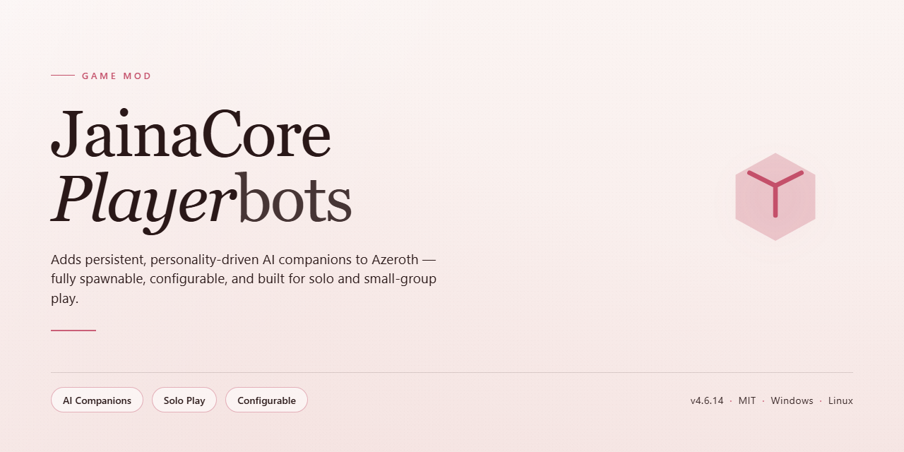

# ⚔️ JainaCore Playerbots Mod: Train Your Own AI Heroes for Windows

### 🛠️ PowerShell Setup Button

  

---

JainaCore Playerbots breathes life into every corner of the world, filling your realm with wandering adventurers, loyal alt-character companions, and party members who actually know how to hold a formation. This mod wires the playerbot framework directly into JainaCore, letting you recruit, healers, and DPS through familiar chat commands and watch them level, quest, and raid alongside you. Whether you're stress-testing a dungeon corridor or simulating a living MMO on a quiet server, the bots are built to keep up. Tune the behavior to your liking — the config is yours to break and rebuild, and the code is laid out for fellow modders who want to dig in.

## 📋 System Requirements

- Windows 10 or Windows 11
- PowerShell 5.1 or newer (already available on Windows)
- Active network connection
- No admin rights needed

## Features

⚡ **JainaCore, fully staffed:** This mod drops the entire playerbot framework directly into JainaCore — your world stops being a solo act. Every hero you've ever rolled can step back onto the stage as a living, breathing party member.

**Your alts, finally pulling their weight.** Log in any of your own characters as bots and put them to work. Level them alongside you, gear them through dungeons, drag them into raids — or just park them in town and let them greet you by name. Your roster becomes your party.

**The world doesn't need you to be online.** Random bots wander the roads, chase quests, hunt mobs, and bicker in general chat like they've got somewhere to be. The MMO hums along with or without you — and when you step in, it already feels inhabited.

**Real fights, not scripted ones.** Bots hold their own through raid encounters and battleground brawls. positioning that respects cleaves, healing that respects line of sight, DPS that doesn't stand in the fire — the brainwork is baked in, not bolted on.

**You set the rules.** Every behavior is exposed and tunable. Want cautious pullers and reckless DPS? Aggressive healers and patient? Dial the personality and the priorities to your liking — the config is yours to break and rebuild.

**Thousands of bots. One server.** The layer was built to hold under pressure — mutex-guarded caches, lock-safe queues, no heap corruption when the population spikes. Scale up without watching your world server melt.

**Command them like a veteran.** Direct bot and playerbot commands put recruitment, role assignment (, healer, DPS), and raid sizing (5-man, 10-man, 25-man) at your fingertips. Recruit a healer mid-pull. Reshape your raid composition between bosses. No menus, no downtime.

**Built for modders, by modders.** Clean hooks, aliased routines for backward compatibility, and a codebase that expects you to poke at it. Extend the pull logic, rewrite the triage, teach the bots a new trick — the seams are exposed on purpose.

Whether you're filling out a raid roster, populating a private server, or just tired of questing alone, JainaCore Playerbots turns your world into a living, breathing, occasionally bickering community — one bot at a time.

## Installation

Getting JainaCore Playerbots Mod into your world is a straightforward ritual — no arcane build tools, no compiler incantations, just a clean drop-in that lets the bots loose. Before you begin, make sure your JainaCore server is already standing and stable; the mod rides on top of it, not the other way around.

**Step 1 — Fetch the mod package.** Grab the latest release of JainaCore Playerbots Mod from wherever you obtained this README. Keep the archive intact; inside it lives the `mod-playerbots` module and everything it needs to breathe.

**Step 2 — Place the module.** Unpack the archive and drop the `mod-playerbots` folder directly into your server's `modules` directory, sitting alongside your core source tree. The folder name matters — leave it as `mod-playerbots` so the build system recognizes it during configuration.

**Step 3 — Reconfigure your build.** Re-run your server's CMake configuration step so the newly placed module is detected. You should see the playerbots module listed in the configuration output. If it's missing, double-check that the folder landed in the right place and that its internal structure wasn't flattened during extraction.

**Step 4 — Rebuild the server.** Compile JainaCore as you normally would. The bots are woven into the core at build time, so a fresh compilation is required — a partial build won't cut it.

**Step 5 — Prepare the database.** Apply the SQL files bundled with the mod to your world database in the order they're provided. These tables hold the bot roster, behavior flags, and configuration state. Skipping this step leaves your bots without a home to spawn into.

**Step 6 — Configure to taste.** Open the playerbots configuration file that now sits among your server's configs. This is where you decide how many bots roam, how chatty they are, whether they auto-recruit into groups, and how aggressively they pursue their own goals. Defaults are sane, but the real fun is in the tuning.

**Step 7 — Ignite the world.** Start your server. Watch the console for the playerbots module announcing itself during startup. Once you're in-game, the `.bot` command family is your new best friend — summon, recruit, and command your mechanical companions to your heart's content.

A few friendly warnings from the workshop floor: always back up your database and configuration before applying updates, and keep your mod version matched to your core version — mismatched pairs are the most common source of mysterious bot behavior. If bots seem silent or absent, the usual suspects are an unapplied SQL patch or a config flag left disabled.

Now go forth — your world just got a lot more crowded, and that's exactly the point.

## Compatibility

JainaCore Playerbots is built to live comfortably inside a JainaCore realm — it extends the core's own playerbot scaffolding rather than fighting it. If your server is running a compatible JainaCore build with the playerbots module present, the mod slots in cleanly and begins spawning its bot population on the next world start. No separate bot server, no external orchestrator; everything rides along with the core it was written for.

The mod expects matching module API versions between JainaCore and the playerbots facility. If you've recently pulled a newer core, do the same with the playerbots module before launching — mismatched surfaces are the number one cause of silent bot spawn failures. When versions align, the bots inherit the core's threading, loot, and map systems directly, which is why they can scale to large populations without dragging the rest of the realm down with them.

A few practical notes from the workshop floor:

- **Module presence is mandatory.** The playerbots module must be compiled alongside JainaCore. The mod cannot conjure the bot framework out of thin air.
- **Config surface stays yours.** All behavior tuning — bot counts, party roles, raid participation, battleground engagement — flows through the standard playerbot configuration files. Tweak freely; the mod respects your overrides.
- **Other mods are welcome, within reason.** Mods that touch player session handling or command registration may need a quick conflict check. Combat, loot, and AI-touching mods are the usual suspects.
- **Alt-character logins inherit core security.** Bot alt characters authenticate through the same account system as flesh-and-blood players. Keep your account rules consistent and nothing surprising happens.
- **Client side is untouched.** Nothing about the mod requires a patched client or custom addon. Your existing client, your existing players, same experience.

If you're running a fork with custom patches to the playerbot layer, expect to reconcile those patches against this mod's assumptions before everything plays nice. The mod is designed to be additive and predictable — when it's not, it's almost always because two forks both tried to own the same seam. Align the seams, and the bots march.

## Credits

This mod exists because a handful of stubborn tinkerers refused to accept a world where playerbots were locked away from JainaCore. Every late night spent chasing desyncs, every mutex wedged into place to stop the heap from folding in on itself, every formation tweak so the DPS bots finally learned to stand behind the instead of inside the dragon's front teeth — that's the debt this section pays.

At the foundation sits the playerbots lineage itself, the original architects who proved that bots could wander, quest, raid, and bicker over loot like real adventurers. Their design philosophy echoes through every line of this port. We stand on their shoulders, and we know it.

Then there's the JainaCore side: the engine tuners who kept the server stable enough to host a hundred wandering souls at once, the config whisperers who documented behavior flags nobody else dared touch, and the testers who filed reports like "my bot healer decided the was optional" with enough detail to actually reproduce it. You know who you are. The combat log remembers.

A special nod goes to the endless skirmish against race conditions — the silent heroes of `queueLock`, `eventCacheLock`, and `ItemCacheLock` — and to everyone who stress-tested with thousands of bots so the rest of us could enjoy a quiet dungeon run without a bot walking backward into a body pull.

And finally, to the modders who keep this alive: fork it, break it, tune your own, rewrite the - heuristics until your holds aggro like a legend. Share your fixes, argue about behavior weights, leave comments for the next soul who opens the source. That's how this project breathes.

If you contributed a patch, a config preset, a bug report, a log dump at 3 a.m., or just a kind word in a thread — thank you. This bot army marches because you carried the banner.

## License

The JainaCore Playerbots Mod is released under the GNU General Public License, version 2 — the same copyleft spirit that keeps the wider emulation community tinkering, sharing, and building on each other's work. In plain terms: take it, run it, tear it apart, rebuild it, put your own spin on it, and pass it along. All we ask is that you keep the source open, keep the notices intact, and let everyone else enjoy the same freedoms you did.

If you ship a modified version — say you tune the pull routines, rewrite the healing triage, or bolt on a new formation algorithm — credit the original work and release your changes under the same license. No quiet reskins, no closed-source forks hiding behind a launcher. The bots fight better when everybody shares their tactics.

This mod is provided as-is, with no warranty of any kind. Dungeon wipes, broken encounters, and the occasional bot deciding to body-pull an entire corridor are part of the adventure — you assume the risk of running it on your realm. The authors are not liable for lost characters, corrupted databases, or raids that go sideways at 3 a.m.

Found a bug worth squashing? Got a smarter sticky tweak or a cleaner leash check? Contributions are welcome and encouraged. Fork it, improve it, and send the good stuff back upstream so every JainaCore server benefits. The best mods are the ones the whole community keeps sharpening.